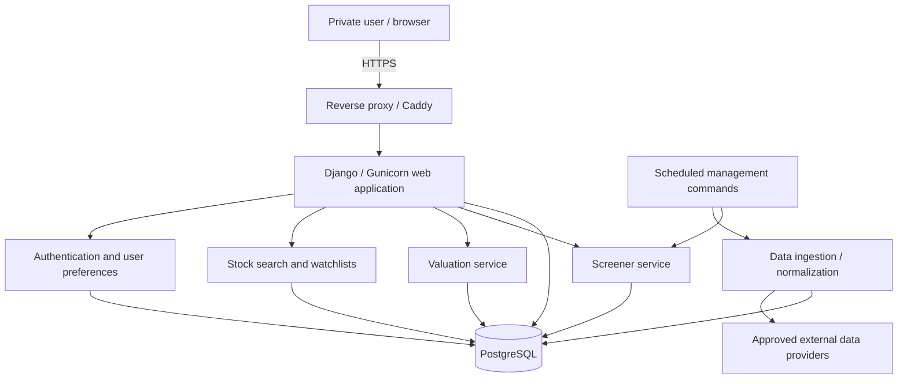
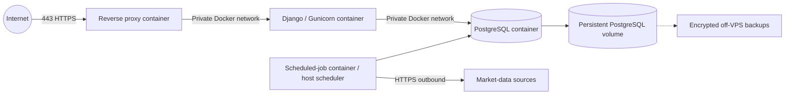

# Securities Analysis — Architecture

**Status:** Proposed design / initial architecture decision  
**Date:** 2026-10-21  
**Related issue:** [#1 — Define MVP scope and frontend architecture](https://github.com/haberrj/securities-analysis/issues/1)

> This document describes the **target architecture**, not an existing deployed system. Initial decisions are recorded below; unresolved provider, VPS, and operational choices are marked as such.

## 1. Context and goals

Securities Analysis is a personal, browser-accessible research application. Its primary purpose is to collect delayed/batch financial data, calculate transparent intrinsic-value estimates, rank undervalued securities under comparable assumptions, and track securities of interest. Covered-call and other options research are planned extensions.

### Functional goals (MVP)

1. Search and view supported stocks and their financial fundamentals.
2. Calculate an explainable intrinsic value for a user-defined investment horizon and expected annual return.
3. Configure and save valuation assumptions and historical calculations.
4. Screen/rank a stock universe under consistent model assumptions.
5. Maintain personal favourites and watchlists.
6. Access the app remotely through a private login.

### Non-functional goals

- Low cost and low maintenance at single-user scale.
- Reproducible valuations with observable source-data provenance.
- Simple automated tests and independently testable financial formulas.
- Graceful handling of missing data, provider failures, and stale prices.
- Secure public-internet deployment without exposing the database.
- Ability to add more valuation methods and delayed options data without rewriting the application.

### Deliberate non-goals for MVP

Live streaming market data, trading/order placement, automated investment advice, a brokerage integration, complex options strategy simulation, LLM chat, SaaS subscriptions, public registration, Kubernetes, microservices, and a separate React SPA.

## 2. Architecture decisions

| Topic | Decision | Rationale / implications |
| --- | --- | --- |
| Architecture | Modular Django monolith | One codebase/deployment; explicit internal boundaries; simple to operate |
| Backend | Django + Python | Built-in authentication, admin, ORM, migrations, templates and ecosystem |
| Frontend | Server-rendered Django templates; HTMX or small JS enhancements where useful | Lower complexity for search, tables and forms; React deferred |
| Database | PostgreSQL | Relational consistency, historical observations, saved valuations and indexing |
| Deployment | Single VPS, Docker Compose | Cost-controlled first deployment; easier to debug than multi-service cloud infrastructure |
| HTTP / TLS | Reverse proxy (Caddy recommended) -> Gunicorn -> Django | HTTPS termination and clear application boundary |
| Background work | Management commands + OS/Compose scheduler | Sufficient for daily/weekly batch tasks; avoid Redis/Celery until needed |
| Data access | Provider adapter interface; source to be evaluated | Swappable sources and auditable ingestion |
| Access | Private authenticated app, initially one manually provisioned account | No sign-up workflow; keep user-owned objects for future multi-user support |
| Calculation design | Pure Python valuation services, independent of views and provider clients | Unit-testable and reusable in batch screeners |
| Production database | PostgreSQL container with persistent storage, on a private Docker network | Minimal early operating cost; operator is responsible for backup and updates |

These choices can be revised with an architecture decision record if measured complexity, scale, or user experience demands it.

## 3. Logical component diagram



The arrows indicate logical dependencies, not separate microservices. All business modules may run inside the same Django codebase. Jobs can use the same application image with a different command/entry point.

## 4. VPS deployment topology

**Target:** one small Linux VPS; exact host and capacity remain open. Start with a modest instance and monitor ingestion runtime, database size, RAM, and disk usage before scaling. VPS resource guidance is an estimate, not a measured requirement.



### Runtime responsibilities

| Service | Responsibilities | Public ports |
| --- | --- | --- |
| Reverse proxy | TLS certificates/renewal, HTTPS redirect, request forwarding | 80/443 only |
| Django web | Forms, pages, authentication, valuation requests, business logic | None directly |
| PostgreSQL | Application data and history | None |
| Scheduler / worker | Data refresh, rank-cache recomputation, job status | None |

For local development, a Docker Compose override may expose Django on localhost. Production should not publish PostgreSQL or Gunicorn directly to the internet. Docker volumes must survive image/container replacement.

### Initial operations

- Deploy from a versioned image or known Git revision; apply migrations during a controlled deploy.
- Maintain a small, documented environment configuration; keep secrets out of Git, images and client-side bundles.
- Restrict host firewall to SSH (ideally key-only and limited to trusted sources), HTTP and HTTPS.
- Enable security updates, host monitoring, and enough free disk space for ingestion + backups.
- Back up PostgreSQL off the VPS on a recurring schedule, encrypt backup artifacts, set retention, and **test restoration**.
- Monitor database availability, storage capacity, job failures and unusually old market data.
- Establish a restart/recovery playbook before relying on the app remotely.

**Open operational choices:** VPS provider/region, domain, backup destination, exact schedule, Caddy vs another reverse proxy, and deployment automation. Do not assume the system is configured until those tickets are implemented and tested.

## 5. Internal module boundaries

These are logical Django application boundaries; names are suggestions, not a required directory tree.

| Module | Owns | Avoids |
| --- | --- | --- |
| `securities` | Security identity, exchanges, company metadata, prices, financial statements | Calculation formulas |
| `ingestion` | Provider clients, imports, normalization, provenance, refresh tracking | Rendering web pages |
| `valuations` | Pure mathematical models, assumptions, snapshots, per-share fair value | Direct network requests inside formulas |
| `screening` | Batch rank calculation, filtering, saved screen configurations, cache freshness | N simultaneous live provider calls |
| `watchlists` | User-owned lists and memberships | Duplicating financial market data |
| `accounts` | Private authentication, settings, access checks | Implementing an unnecessary public signup system |
| `options` (later) | Contract metadata, delayed option-chain observations, covered-call calculations | Brokerage trade execution |

### Layering rule

- **Provider adapter:** retrieves and validates upstream data, including provider metadata.
- **Storage/domain layer:** normalizes observations and manages persistent entities.
- **Calculation layer:** deterministic, side-effect-free valuation/payoff functions consuming validated inputs.
- **Application layer:** orchestrates use cases such as 'value security' and 'screen universe'.
- **Web layer:** handles request validation, authentication, templating and user feedback.

The domain layer should not depend on HTTP, templates, or a specific data vendor. We can add JSON endpoints for charts or external integrations without committing to a React frontend.

## 6. Proposed data model

Illustrative entities, to be finalized in [#3](https://github.com/haberrj/securities-analysis/issues/3):

| Entity | Important information |
| --- | --- |
| `Security` | Stable internal ID, ticker, exchange, identifiers, company name, trading/reporting currency |
| `PriceObservation` | Security, quote date/time, price type, currency, source, observed/ingested timestamps, adjustment basis |
| `FundamentalObservation` | Security, metric, value, units/currency, fiscal period, publication/availability date, provider |
| `IngestionRun` | Provider, universe, timestamps, status, record counts, errors and retries |
| `ValuationPreset` | Owner, model, horizon, discount/expected return, growth, P/E or terminal assumptions, safety margin |
| `ValuationRun` | Owner, security, model/version, complete inputs and assumptions, output, currency, as-of/computation time |
| `ScreenRun` | Universe, model/preset snapshot, ranking date, eligible/excluded counts and result cache |
| `Watchlist` / `WatchlistEntry` | Owner, name, tracked security, optional notes and created date |
| `OptionContract` / `OptionQuote` (later) | Underlying, contract identifiers, expiry, strike, right, multiplier, timestamps, bid/ask, Greeks |

### Ownership and identity

- Market data can be shared read-only across accounts.
- Watchlists, presets, historical personal valuation runs, and future portfolios have explicit `user` ownership, even if only one user exists at launch.
- A ticker string is **not** a globally unique security identifier; exchange, listing, share class and other identifiers matter.
- Use strong database constraints for idempotent imports and to prevent duplicate list memberships.

## 7. Data provider and refresh strategy

**Provider choice is open:** see [#4](https://github.com/haberrj/securities-analysis/issues/4). Evaluate legal permissions, licence/redistribution limits, rate limits, availability, costs, US/Canadian coverage, financial periods and point-in-time history before choosing between an API and a scraper.

### MVP data flow

1. A scheduled task requests a defined stock universe and financial observations.
2. The adapter validates data, units, provider timestamps and source identifiers.
3. The importer upserts identities and appends/version-stores observations without silently erasing historical snapshots.
4. A screening batch re-evaluates eligible stocks for a shared valuation preset.
5. Django reads stored results and displays freshness indicators.

### Suggested initial cadence (to be validated against provider limits)

- Prices: once per trading day **after the relevant market close**.
- Company fundamentals: weekly or on new filing availability.
- Rankings: recompute after financial-data refresh or preset changes.
- Single-ticker valuation: on demand using stored, timestamped inputs.

A failed ticker should be recorded and retried without aborting the full import. Jobs should be idempotent and protect against overlapping runs. A first implementation can use scheduler commands and a database-backed lock rather than a task queue.

### Time and currency conventions

- Store event/ingestion timestamps as timezone-aware UTC timestamps; display them in the user's preferred timezone.
- Distinguish **market session date**, fiscal period end, public/filing date, provider observation time, ingestion time and valuation calculation time.
- Always show the traded price's currency and the valuation's currency. Do not mix currencies without a dated, explicitly sourced FX conversion.
- Document and preserve units (e.g., dollars vs millions) and share basis (basic/diluted, split-adjusted) for each financial observation.
- Missing, negative and stale inputs must be explicit; no silent substitution of zero or unverified historical values.
- Backtesting (future) must use data actually available **as of** the simulated date, avoiding look-ahead and survivorship bias.

The default first screening universe can be US-listed equities if provider coverage makes this straightforward; Canadian and other markets should remain extensible rather than implied as supported from day one.

## 8. Valuation model design

The initial model is based on the earlier [SecurityTrading intrinsic value implementation](https://github.com/haberrj/SecurityTrading/blob/master/Stocks/intrinsic_value.py), but it should be **re-specified and tested**, not copied blindly.

### Configurable earnings-based model

Core inputs:

- Current and/or normalized EPS (with definition and effective financial period).
- Forecast annual earnings growth rate and terminal P/E (either provider-derived or explicitly overridden).
- Forecast horizon **N years**.
- Required annual return / discount rate `r`.
- Margin of safety `s`, represented consistently as a fraction between 0 and 1.
- Price snapshot for comparison, including quote timestamp/currency.

Illustrative formula, assuming a constant annual EPS growth rate and terminal P/E:

```text
projected_EPS_N = EPS_0 × (1 + growth_rate)^N
terminal_share_value_N = projected_EPS_N × terminal_PE
fair_value_today = terminal_share_value_N / (1 + required_return)^N
buy_below_price = fair_value_today × (1 - margin_of_safety)
upside_to_fair_value = fair_value_today / current_price - 1
```

This is an earnings/terminal-multiple model, **not a free-cash-flow DCF**. A five-year horizon must compound and discount over five periods, not the four periods in the old script. If negative earnings, negative terminal multiples, missing growth estimates or dubious assumptions make the result meaningless, produce an explicit 'cannot value reliably' state instead of an automatic buy/sell signal.

**Important distinction:** `fair_value_today` is the model estimate; `buy_below_price` applies the requested safety margin. They must not be conflated. A screener can rank by potential upside to fair value and optionally filter by whether the price is below the buy threshold.

### Reproducibility and uncertainty

Every stored run must keep the model version, all effective input values, date of observations, source/provider, currency, assumptions and outputs. Show an explanation and warnings for high uncertainty, missing values, extrapolation, or aged data. DCF and sensitivity tables are separate later work (issue [#7](https://github.com/haberrj/securities-analysis/issues/7)).

## 9. Ranking and caching

Rankings must compare companies using a consistent universe, model version and assumptions preset. They should not silently compare an optimistic growth model for one ticker with a conservative model for another.

- Compute screening results in a background batch and cache/persist them, rather than executing hundreds of valuations on every web request.
- Rank eligible stocks by modeled upside/downside (or a clearly named alternative score); display price, fair value, margin-of-safety threshold, data date and model.
- Filter invalid calculations, unsupported markets/currencies and incomplete financial inputs according to documented eligibility rules.
- Preserve an explanation for exclusions and show the age of the cached screening run.
- A high nominal upside is **not** a confidence score; future financial-quality signals can be added separately.

## 10. User interface and authentication

### Planned screens

- Login/logout.
- Overview dashboard and ingestion freshness.
- Search / company detail with fundamental inputs.
- Valuation calculator, assumptions/presets and detailed results.
- Ranked undervaluation screener with filters and sorting.
- Personal watchlist/favourites.
- Covered-call research page (later).

### UI choice

Django templates provide the default page experience. HTMX and small JavaScript components can support asynchronous search, table filtering, partial updates and charts. JSON views may be added when helpful. Reconsider React if a complex options workflow genuinely requires client-side state management, not as a default upfront dependency.

### Access policy

- Private deployment with one manually provisioned Django user initially.
- No anonymous access to business data; no public registration, password-reset-by-email dependency, or multi-tenant billing.
- Built-in Django authentication with secure session cookies and CSRF; add login attempt throttling and preferably TOTP-based MFA before public internet use.
- Scope personal resources to the authenticated owner; never trust a URL-supplied owner ID.
- Django admin should be available only to authorized accounts, with hardened access and preferably additional restrictions.

## 11. Security and operations baseline

**Because the app is reachable over the public internet, a single-user design does not imply low security requirements.**

- Enforce HTTPS; configure secure session and CSRF cookies, allowed hosts, trusted origins and safe proxy headers.
- Use an SSH-key-only VPS admin account, least privilege, security updates and minimal firewall exposure.
- Do not publish the PostgreSQL port; restrict inter-container traffic to the required services.
- Avoid logging passwords, API keys, broker tokens, financial account details or raw secrets.
- Configure network timeouts and bounded request/retry behaviour for external data providers.
- Create encrypted, off-host PostgreSQL backups on a schedule and periodically verify restore procedures.
- Use health checks, job-status monitoring, and alerts for persistent job failures or stale market data.
- Future broker connectors should be read-only by default; no broker keys belong in browser sessions or frontend bundles.
- Apply vulnerability updates to OS, Docker images, and Python packages on a planned cadence.

## 12. Quality and implementation plan

Automated tests should cover pure financial maths, unusual growth/EPS cases, time horizon off-by-one errors, currencies and financial units, deterministic example valuations, source-data parsing, ingestion retries/idempotency, per-user access rules, and ranking consistency.

| Phase | Deliverable | Tracking |
| --- | --- | --- |
| 1 — Foundation | Reproducible Django/PostgreSQL Docker app, baseline security and CI | [#2](https://github.com/haberrj/securities-analysis/issues/2), [#13](https://github.com/haberrj/securities-analysis/issues/13), [#14](https://github.com/haberrj/securities-analysis/issues/14) |
| 2 — Data | Schema, provider selection and repeatable batch ingestion | [#3](https://github.com/haberrj/securities-analysis/issues/3), [#4](https://github.com/haberrj/securities-analysis/issues/4), [#5](https://github.com/haberrj/securities-analysis/issues/5) |
| 3 — MVP product | Valuation engine, saved runs, search, rankings, watchlists and UI | [#6](https://github.com/haberrj/securities-analysis/issues/6), [#8](https://github.com/haberrj/securities-analysis/issues/8), [#9](https://github.com/haberrj/securities-analysis/issues/9), [#10](https://github.com/haberrj/securities-analysis/issues/10), [#11](https://github.com/haberrj/securities-analysis/issues/11), [#12](https://github.com/haberrj/securities-analysis/issues/12) |
| 4 — Next phase | DCF and covered-call options research | [#7](https://github.com/haberrj/securities-analysis/issues/7), [#15](https://github.com/haberrj/securities-analysis/issues/15), [#16](https://github.com/haberrj/securities-analysis/issues/16) |

## 13. Unresolved questions / decision log

| Decision | Current position | Resolve in |
| --- | --- | --- |
| VPS provider, region and exact size | Not yet selected; choose based on budget, backup options and performance | Deployment implementation |
| Domain and DNS | Not yet selected | Deployment implementation |
| Market-data provider and licensing | Must be evaluated; no assumed right to scrape/distribute | [#4](https://github.com/haberrj/securities-analysis/issues/4) |
| Initial supported universe | Prefer manageable US equities; assess Canadian listing needs/provider support | [#4](https://github.com/haberrj/securities-analysis/issues/4) |
| Initial growth/terminal P/E defaults | Show sourced estimates and allow explicit overrides; validate carefully | [#6](https://github.com/haberrj/securities-analysis/issues/6) |
| Background scheduler implementation | Simple scheduled management commands initially | [#5](https://github.com/haberrj/securities-analysis/issues/5) |
| React and rich frontend | Defer until justified by complex interaction | Future decision |
| DCF, covered calls and LLM chatbot | Post-MVP | [#7](https://github.com/haberrj/securities-analysis/issues/7), [#15](https://github.com/haberrj/securities-analysis/issues/15), [#16](https://github.com/haberrj/securities-analysis/issues/16) |

## 14. Architectural review triggers

Revisit this design when one or more of the following become true: ingestion exceeds reasonable VPS capacity; asynchronous or long-running workflows require a job queue; options analysis needs extensive realtime client interactivity; historical financial data becomes too large for current storage/indexing; actual multi-user requirements emerge; or a provider's licensing requirements affect deployment or caching.

Until then, prioritize understandable code, reliable financial data, and transparent calculations over infrastructure complexity.
